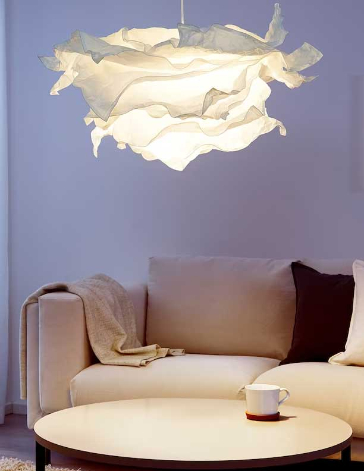
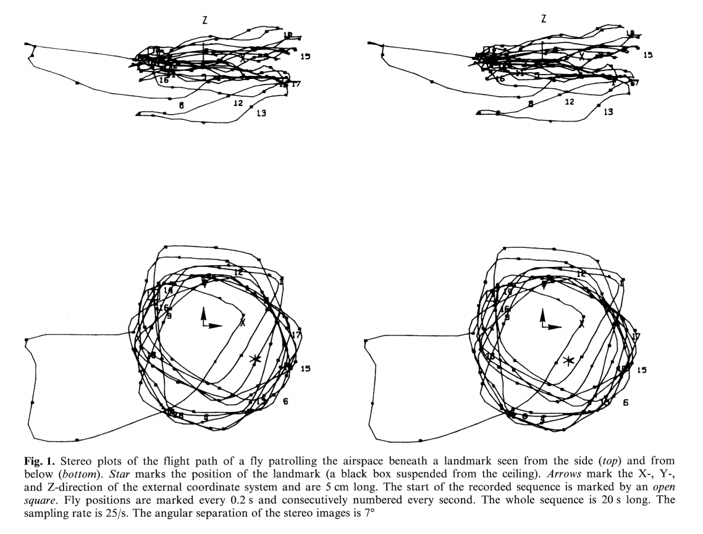

# lesser-house-boids

## Introduction

#### What?
I'm trying to build a simple model of the flight of the lesser house fly (_Fannia canicularis_).

#### Why?

During the summer months, I lie beneath a fabulous pendant lampshade (thank you <a href="https://www.ikea.com/gb/en/p/krusning-pendant-lamp-shade-white-50259921/">IKEA</a>) which is often the resting spot for a small number of flies doing their thing. And their thing is kind of cool. I have observed three distinct flight behaviours
	<ol>
		<li>resting on the pendant lampshade</li>
		<li>a slow, square-like trajectory of approximately 40cm in width,</li>
			<li>and a rapid, more irregular "zooming" behaviour when near another fly.</li>
	</ol>

Having noticed these distinct behaviours, I asked why they do this. And found that <a href="https://www.jstor.org/stable/4599948">someone has documented</a> the properties of the fly's flight, and talked about some of the reasons they do it. The 1986 paper includes some figures which I very much appreciated. And basically, I wanted to reproduce them.

	

#### How?

Creating a simulation of lesser house flies lends its perfectly to agent-based modelling: where you give each fly (or agent) a prescribed list of behaviours, and see how they interact to create large-scale, emergent behaviours. Specifically, it might be interesting to see how the prescribed behaviours need to be defined in order to observe "zooming" at a similar frequency to real life.

Agent-based modelling is super cool. Watching animals flock and swoop and zoom is incredible and simple agent-based models have given insight into how emergent behaviours of large groups come about. Agent-based modelling has also been applied in cell biology to study morphogenesis, tumour growth and metastasis and formation of bacterial biofilms. These types of models (particularly as applied to morphogensis) are relevant to the work done in my PhD.

## Building

### Frame

The set-up has a few components.

1. The agents are permitted to move anywhere in a 400 x 400 frame.
2. We have set periodic boundary conditions (for the moment).
3. 10 boids start at random positions with random velocities.
4. A light is shown of set height and radius, and hanging a given dsistance from the celiing.

### Agents

The agents have 4 set states.

1. Resting
2. Flying
3. Moving to resting
4. Zooming

##### Resting

* An agent should only be resting on the surface of the light.
* Its velocity should be zero.

##### Flying

* The velocity in the z-direction should be less than that in the x and y directions.
* The speed of the fly should be relatively constant.
* The fly should move in an approximately square trajectory in the xy plane, around 50cm x 50cm.
* The vertical extent of the trajectory should be around 25cm, around 60cm below the pendant light.

## References

Figure reproduced from 
Jochen Zeil. (1986). The Territorial Flight of Male Houseflies (Fannia canicularis L.). _Behavioral Ecology and Sociobiology_, 19(3), 213–219. [URL](http://www.jstor.org/stable/4599948)

Fly png images are downloaded from [PNGWING](https://www.pngwing.com/).

